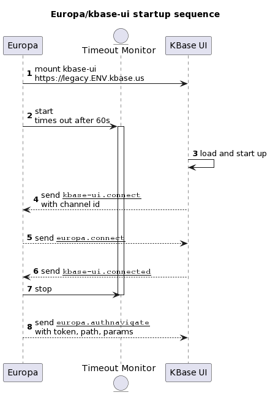

# Euoropa Integration of kbase-ui

In 2024 kbase-ui became a client application of the Europa UI. At the same time,
kbase-ui had undergone a slow transformation from an old-school AMD javascript
to a "modern" React / Typescript web app.

The initial Europa integration was based on the old kbase-ui codebase. It basically
worked, but was incomplete and carried several important defects. Soon after this
release, the next release was based on the new kbase-ui codebase, and a refactored
integration.

We'll not discuss the original implementation in detail.

## Overview

The integration itself is based almost purely on "window messages" passed back
and forth between Europa and kbase-ui.

A "window message" is a browser DOM event of type "message" that is only
implemented on windows. A window, in this context, is either the main browser
window or an iframe. In the Europa/kbase-ui integration, Europa is associated
with the main browser window, and, when loaded, kbase-ui is associated with an
iframe window.

We'll discuss the messaging implementation later, but suffice to say for now
that Europa sends messages to kbase-ui on the iframe window, and kbase-ui sends
messages to Europa on the Europa window.

### Invoking a kbase-ui endpoint

The "hash path" form is that used by kbase-ui since it's inception. The
"fragment identifier" component of a url is used by kbase-ui to match a request
path. This fragment identifier may have parameters attached. One example is the
path to a user profile, which looks like `#people/foo`
(`https://ci.kbase.us#people/foo`) to view the profile for user "foo". Another
is a path to the search page with a pre-supplied query: `#data-search$q=coli`
(`https://ci.kbase.us#data-search$q=coli`).

The "legacy path" is a transformation of the hash path. It is a "normal" URL
path, with a common prefix of `/legacy`. The legacy path form of the examples
above are `/legacy/people/foo` and `/legacy/data-search?q=coli`.

### kbase-ui startup

1. kbase-ui is hosted in an iframe within Europa. As such, kbase-ui comes to life
when the iframe is inserted into the DOM with a `src` url pointing to the
kbase-ui deployment location. Eruopa will naturally perform this when it detects
a url destined for kbase-ui, as described above.

    This is **step 1** of the sequence illustrated in [Diagram 1](#diagram01) below.

2. As Europa creates the iframe, it also creates a "timeout monitor". This is a
separate process which, if it reaches the timeout limit (defaults to 60
seconds), will remove the iframe and display an error message.

    Don't worry, the timeout monitor is canceled in step 7, after the
communication handshake is complete.

3. Back to the loading sequence, kbase-ui should have been contacted at the appropriate
   URL, e.g. `https://legacy.ci.kbase.us`, after which the web app will start loading,
   loading it's configuration, and then ...

4. After kbase-ui loads and it's app starts up successfully, it sends a
   `kbase-ui.connect` message to Europa. This message's payload contains a
   unique "connection id". As described in the [window message
   implemenatation](#window-messaging-implementation), this unique channel id
   ensures that the communication between Europa and kbase-ui is private.

5. After receiving `kbase-ui.connect`, Europa will set up it's channel with the channel
   id, do some housekeeping, and send the message `europa.connect`.

6. After receive `europa.connect`, kbase-ui will do some housekeeping, prepare itself
   for operation, and send the message `kbase-ui.connected`.

7. This last message indicates that the connection between Europa and kbase-ui
   has been established. Europa proceeds to stop the timeout monitor it had
   previuosly started.

8. Finally, Europa sends the message `europa.authnavigate`. This message
   contains the KBase Login Token if Europa is authenticated, and the requested
   path and params from the original request (URL).

   This special message allows kbase-ui to both set up it's authentication state
   and then follow this immediately with a navigation to the requested location.

<div id="diagram01" style="font-style: italic;">
Diagram 1: Europa/kbase-ui startup sequence
</div>



### Login

### Logout

### Navigation

### Authentication Events

## Technical Topics

### URL Formats

There are three URL formats work discussion: kbase-ui "classic" urls, Europa "legacy"
urls, and the kbase-ui "connection" url.

#### Classic kbase-ui hash paths

The "classic" kbase-ui url uses no URL paths, but rather the "fragment
identifier", also known as the "hash". kbase-ui documentation often refers to it
as the "hash path".

For example, a link to a user profile in CI looks like:

```url
https://ci.kbase.us#people/kbaseuitest
```

The reason for this url form is primarily because when kbase-ui was created in 2014,
there was poor support for Javascript to capture the setting of local URL paths.
Honestly, I don't remember how good the support was. Javascript capture of hash change
via the `hashchange` event was available and stable.

In addition to the hash path, kbase-ui also has supported parameters via the
"query string", also known as "search params". This support has come in various
flavors, all of which are still supported. The search params can be on the url,
like:

```url
https://ci.kbase.us?q=coli#data-search
```

or appended to the hashpath

```url
https://ci.kbase.us#data-search?q=coli
```

or, in the preferred form, appended to the hash-path with the dollar sign `$`.

```url
https://ci.kbase.us#datasearch$q=coli
```

The latter is preferred, as the first method, search params, causes a page
reload when the it changes, and the second form works but is invalid url syntax.

A note on the philosopy of hash paths. The "fragment identifier" is designed to
be used to navigate within the resource idenfied by the rest of the url. Thus,
it does seem perfectly appropriate to use the hash path to navigate within
kbase-ui, as it is the resource idenfied by the url and is only loaded one time.

In this context, URL paths almost seem like a misuse, as they do not identify a
resource, but rather a navigation within a resource. Still, what is philosophy
in the fact of practicality? URL paths are very useful for server side
rendering, and are well supported now by the DOM history api.

#### Europa legacy URL

When Europa receives a "classic" kbase-ui URL, it simply reforms it as a
"legacy" URL. The transformation is pretty simple.

- the base url is the origin and any base path; Europa does not have a base path
  (it is on the root), although local development uses /dev.
- take the fragment identifier
- extract the appended params, if any
- extract the url params, if any
- create a query string from the combined params
- form a path by concatenating the legacy path prefix `legacy` and the hash path (sans
  the initial octothorpe `#`)
- attach the params as standard search params

For example

```url
https://ci.kbase.us#people/bart
```

becomes

```url
https://ci.kbase.us/legacy/people/bar
```

Or

```url
https://ci.kbase.us#data-search$q=coli
```

becomes

```url
https://ci.kbase.us/legacy/data-search?q=coli
```

#### kbase-ui connection URL

kbase-ui is attached to Europa through an iframe, whose `scr` attribute is a url
to an instance of kbase-ui. In a deployment, this will be a deployed kbase-ui
instance.

This url must have two parameters in the query string `sendChannelId` and
`receiveChannelId`. These correspond to the channel ids for the Europa/kbase-ui send
channel and receive channel. The values for these are independent uuids (v4).

For instance:

```url
https://legacy.ci.kbase.us?sendChannelId=FOO&receiveChannelId=BAR
```

kbase-ui will overwrite this url in order to remove the channel ids

The url for the iframe never changes after this. All navigation from Europa into
kbase-ui is through the messaging api. All navigation within kbase-ui is via
changes to the fragment identifier (hash) of the window location. Due to the
fact that, as of present, kbase-ui is operating on a subdomain, cross-domain
restrictions kick in and the url changes are not reflected in the iframe src
attribute itself. (In fact, kbase-ui does not have any access to attributes of
the iframe that launched it, which is why we must pass the channel ids in the
url ... in a same-origin implementation we would prefer to use iframe element
attributes.)

Europa and kbase-ui do provide support for hosting kbase-ui on the primary
domain and with a base path. This configuration provides some benefits: It
allows kbase-ui to operate with same-origin policy, which relaxes security,
simplifies deployments, and unlocks some capabilities (e.g. using dispatchEvent
over postMessage).

```url
https://ci.kbase.us/legacy
```

### Window Messaging Implementation

Due to the need to run kbase-ui, initially, on a subhost (e.g. legacy.ci.kbase.us),
