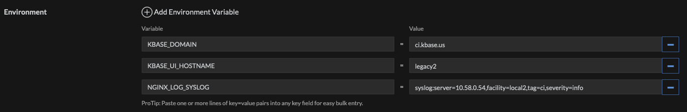

# Environment Variables and Configuration

`kbase-ui` relies upon a set of required and optional environment variables. It
depends upon them in a manner quite characteristic of KBase services, that is,
indirectly by using them to create a configuration file as it is started up.

Upon startup (the Docker command), `kbase-ui` uses `dockerize` to generate two
files: `nginx.conf` for the `nginx` server, and `config.json`, for the
`kbase-ui` web app. The templates for these config files are located in
`deployment/templates`. They are golang templates, which utilize custom
functions provided by
[powerman/dockerize](https://github.com/powerman/dockerize) and
[sprig](http://masterminds.github.io/sprig/).

## Catalog of Environment Variables

Environment variables are divided into those supporting the kbase-ui web app,
and those supporting the nginx server. In addition, these are divided into
required environment variables without defaults and those with defaults, which
can be considered optional.

The fulls set of environment variables, therefore, is the intersection.

The full set of required environment variables is:

- `KBASE_UI_HOSTNAME`
- `KBASE_DOMAIN`

The full set of optional environment variables is:

- `AUTH2_PROVIDERS`
- `KBASE_UI_BASE_PATH`
- `DEFAULT_PATH_TYPE`
- `DEFAULT_PATH`
- `FEATURE_SWITCHES_DISABLED`
- `FEATURE_SWITCHES_ENABLED`
- `NGINX_LISTEN`
- `NGINX_LOG_LEVEL`
- `NGINX_LOG_STDERR`
- `NGINX_LOG_STDOUT`
- `NGINX_LOG_SYSLOG`
- `NGINX_SERVER_NAME`

### Web App (kbase-ui)

The environemnt variables in this section are used directly by kbase-ui.

During container launch, these environment variables are applied to `/kb/deployment/templates/config.json.tmpl`,
which produces `/kb/deployment/app/deploy/config.json`. (See the [the deployment
quickstart](./quick-starts/deployment.md))

#### Required (no defaults)

| Name         | Description                                                                             |
|--------------|-----------------------------------------------------------------------------------------|
| KBASE_DOMAIN | The domain at which Europa, and most KBase user interfaces, operate in this environment |

#### Optional (with defaults)

| Name                      | Default               | Description                                                                                       |
|---------------------------|-----------------------|---------------------------------------------------------------------------------------------------|
| KBASE_UI_BASE_PATH        | "/"                   | The base, or prefix, path kbase-ui should expect; currently unused (but had been planned)         |
| DEFAULT_PATH              | "narratives"          | When kbase-ui is asked to show the dashboard, go here [1]                                         |
| DEFAULT_PATH_TYPE         | "europaui"            | The type of path for the above - either "europaui" or "kbaseui"                                   |
| FEATURE_SWITCHES_ENABLED  | ""                    | Used primarily in CI to enable features that are disabled by default (are under development)      |
| FEATURE_SWITCHES_DISABLED | ""                    | Used primarily in non-CI environments to disable features not supported in the deploy environment |
| AUTH2_PROVIDERS           | "Google,Globus,OrcID" | Which identity providers the auth service supports in the deploy environment                      |

### Nginx Server

These environment variables are applied to the nginx config template
`/kb/deployment/templates/nginx.conf.tmpl` to produce the nginx config file
`/etc/nginx/nginx.conf`.

Note that the `nginx` configs and their defaults were established many years ago
by Steve C., and have not been touched since. They should be considered in the
purview of devops. Local development can take care of itself.

#### Required (no defaults)

| Name              | Description                                                                                                   |
|-------------------|---------------------------------------------------------------------------------------------------------------|
| KBASE_DOMAIN      | The hostname at which Europa and Narrative operate                                                            |
| KBASE_UI_HOSTNAME | The hostname component, if any, to be prefixed to KBASE_DOMAIN on which kbase-ui operates in this environment |

#### Optional (with defaults)

| Name              | Default     | Description                                                                                                                 |
|-------------------|-------------|-----------------------------------------------------------------------------------------------------------------------------|
| NGINX_LOG_SYSLOG  | ""          | If provided, sets an `access_log NGINX_LOG_SYSLOG combined;` stanza, where the value is a valid syslog configuration string |
| NGINX_LOG_STDOUT  | "true"      | if "true", `access_log /dev/stdout;`                                                                                        |
| NGINX_LOG_STDERR  | "true"      | if "true", `access_log /dev/stderr;`                                                                                        |
| NGINX_LOG_LEVEL   | "error"     | adds given log level to stderr (if enabled) and `/var/log/nginx/error.log`                                                  |
| NGINX_LISTEN      | "80"        | The port on which to listen for requests                                                                                    |
| NGINX_SERVER_NAME | "localhost" | The host name on which to listen for requests.                                                                              |

## Usage in CI

Here is an example of the current working configuration in the CI Rancher
service `kbase-ui`:



## All Environments

kbase-ui sports a handy tool to generate environment variables per environment.

```shell
DEPLOY_ENV='ci' KBASE_UI_HOSTNAME='legacy' KBASE_UI_BASE_PATH='' ./Taskfile generate-runtime-env
```

or in the container

```shell
DEPLOY_ENV='ci' KBASE_UI_HOSTNAME='legacy' KBASE_UI_BASE_PATH='' ./scripts/container/generate-runtime-env
```

The short form, omitting empty variables, would be

```shell
DEPLOY_ENV='ci' KBASE_UI_HOSTNAME='legacy' ./Taskfile generate-runtime-env
```

where:

- `DEPLOY_ENV` is one of the KBase deployment environments - ci, ci-europa,
  narrative-dev, next, narrative.
- `KBASE_UI_HOSTNAME` is the hostname component of the kbase-ui domain; If
  kbase-ui is operating on a subdomain; defaults to empty string which causes
  kbase-ui to operate on the primary domain
- `KBASE_UI_BASE_PATH` is the url pathname to reach kbase-ui; defaults to empty string
  and thus kbase-ui operates on the root path

Note that the sister task `generate-runtime-config` will also generate the
kbase-ui and nginx config files, useful for development and debugging the
templates.

Also note that this script generates environment variables suitable for running
kbase-ui locally and in production, with the caveat that with local usage
`NGINX_LOG_SYSLOG` is not utilized, and is empty in the examples below.

The syslog settings we have been using from gitlab are:

- ci: syslog:server=10.58.0.54,facility=local2,tag=ci,severity=info
- next: syslog:server=10.58.0.54,facility=local2,tag=next,severity=info
- appdev: syslog:server=10.58.0.54,facility=local2,tag=appdev,severity=info
- narrative-dev: syslog:server=10.58.0.54,facility=local2,tag=prod,severity=info
- narrative: syslog:server=10.58.0.54,facility=local2,tag=prod,severity=info

I have no idea, other than CI and narrative-dev, if these are the settings
actually used. They are derived from the develop branch of the old kbase-ui
gitlab ini files; I don't have access to the master branch which has the ini
files used in non-ci deployments.

### `ci`

```shell
DEPLOY_ENV='ci' KBASE_UI_HOSTNAME='legacy' ./Taskfile generate-runtime-env
```

which produces:

```shell
FEATURE_SWITCHES_ENABLED='search_features,re-lineage,linked-samples,sampleset-data-links,object-link-to-term'
KBASE_UI_HOSTNAME='legacy'
KBASE_DOMAIN='ci.kbase.us'
```

Note the usage of single quotes - we don't need string interpolation.

Note also that this is not the full set of environment variables. Any missing
environment variables will have default variables provided by the script or in
their respective templates.

```shell
DEPLOY_ENV='ci-europa' KBASE_UI_HOSTNAME='legacy' ./Taskfile generate-runtime-env
```

which produces:

```shell
AUTH2_PROVIDERS='Google,Globus,OrcID'
KBASE_UI_BASE_PATH=''
DEFAULT_PATH_TYPE='europaui'
DEFAULT_PATH='narratives'
FEATURE_SWITCHES_DISABLED=''
FEATURE_SWITCHES_ENABLED='search_features,re-lineage,linked-samples,sampleset-data-links,object-link-to-term'
KBASE_UI_HOSTNAME='legacy'
NGINX_LISTEN='80'
NGINX_LOG_LEVEL='error'
NGINX_LOG_STDERR='true'
NGINX_LOG_STDOUT='true'
NGINX_LOG_SYSLOG=''
NGINX_SERVER_NAME='localhost'
KBASE_DOMAIN='ci.kbase.us'
```

### `ci-europa`

```shell
DEPLOY_ENV='ci-europa' KBASE_UI_HOSTNAME='legacy' ./Taskfile generate-runtime-env
```

which produces:

```shell
FEATURE_SWITCHES_ENABLED='search_features,re-lineage,linked-samples,sampleset-data-links,object-link-to-term'
KBASE_DOMAIN='ci-europa.kbase.us'
```

### `next`

```shell
DEPLOY_ENV='next' KBASE_UI_HOSTNAME='legacy' ./Taskfile generate-runtime-env
```

which produces:

```shell
KBASE_DOMAIN='next.kbase.us'
```

### `narrative-dev`

```shell
DEPLOY_ENV='narrative-dev' KBASE_UI_HOSTNAME='legacy' ./Taskfile generate-runtime-env
```

which produces:

```shell
KBASE_DOMAIN='narrative-dev.kbase.us'
```

### `appdev`

```shell
DEPLOY_ENV='next' KBASE_UI_HOSTNAME='legacy' ./Taskfile generate-runtime-env
```

which produces:

```shell

AUTH2_PROVIDERS='Google,Globus'
KBASE_DOMAIN='appdev.kbase.us'
```

Note that appdev has a custom setting for `AUTH2_PROVIDERS`, because `ORCID`
sign in is not supported.

### `narrative2`

```shell
DEPLOY_ENV='narrative2' KBASE_UI_HOSTNAME='legacy' ./Taskfile generate-runtime-env
```

which produces:

```shell
KBASE_DOMAIN='narrative2.kbase.us'
```

### `narrative` (aka "prod" or "production")

```shell
DEPLOY_ENV='narrative' KBASE_UI_HOSTNAME='legacy' ./Taskfile generate-runtime-env
```

which produces:

```shell
KBASE_DOMAIN='narrative.kbase.us'
```
